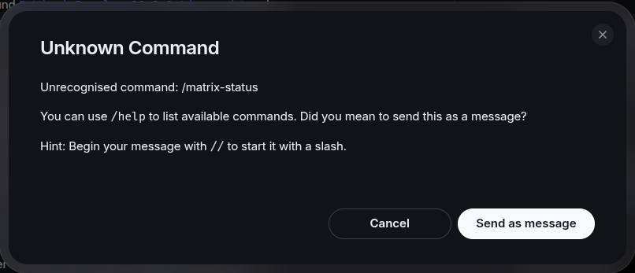

# Quick Start

Go from install to a working room in about ten minutes. You need: a working
Pi installation (Node 22 or newer), a Matrix homeserver you can create
accounts on, and a Matrix account for the agent (its own — never your
personal one).

The layout worth following: **one agent account per server (required), one
project : one Pi session : one Matrix room (recommended)** — each project's
room is its shared, persistent record. Every Pi session then opens its own
`🧵` thread inside the room, so the main line stays clean. Giving each
project its own agent account is optional, for advanced setups. Threads
render best in Element Desktop; in Element X they are a Labs feature.

## 1. Install the extension

```bash
pi install npm:pi-matrix-integration
```

(As a beta from git: `pi install git:github.com/r3dnl/pi-matrix-integration@v0.9.0`.
From a checkout: `pi install /path/to/pi-matrix-integration`.)

### 1b. Voice messages (optional)

Voice-message transcription needs `ffmpeg` on the machine running Pi
(`sudo apt install ffmpeg` on Debian/Ubuntu). It is the only thing that
uses it; without it, voice notes are not transcribed and the room gets a
warning instead.

### 1c. Subagents (optional but recommended)

room-mode thread summaries and sub-agent visibility need a sub-agent extension:

```bash
pi install npm:@tintinweb/pi-subagents
```

### 1d. Decision Dialogues (optional but recommended)

The [decision questionnaires](docs/user/ask-user-pairing.md) come from a separate extension. Install it, then
apply the question-mirror patches (one command, idempotent; enables full
terminal ↔ room synchronisation of decision questionnaires). `apply.sh` calls
`patch`, so install that first if your machine has none (`apt-get install patch`).

```bash
pi install npm:@juicesharp/rpiv-ask-user-question
sh ~/.pi/agent/npm/node_modules/pi-matrix-integration/patches/rpiv-ask-user-question/apply.sh
```

## 2. Prepare the room

1. Create the agent's account on your homeserver (see your server's
   documentation for account creation).
2. Create a room for the project and invite the agent. Keep it
   invite-only — room members can drive the agent.
   (Skip this if you let the login create the room instead — see step 3,
   the invite question.)

### Manual Room Setup

Use this when your homeserver forbids the agent account from creating
rooms, setting aliases, or inviting users:

1. With your **personal** account, create the room and invite the agent.
   Give the room an alias — the login prompt resolves rooms by alias, not
   by room ID (or pre-set `roomId` in the
   [config](docs/user/configuration.md)). Only room members can drive the
   agent — keep the room invite-only.
2. Open Pi: it will ask you to log in. Enter the room's alias when
   prompted. You can always `/matrix-login` to start this flow manually.

## 3. Log in and connect

Start Pi in your project directory:

```bash
cd <project> && pi
```

This will automatically start the login process (`/matrix-login`) and upon completion it will ask if you want to see the `/matrix-introduction-tour`.

The room prompt proposes `#<project-dir>:<homeserver>`. If that room does not
exist yet, the login creates it and then asks "Invite user to room" — type
your personal Matrix ID there, the invite is how you get in. If the room
already exists (e.g. the one you created in step 2, or one left over from an
earlier login attempt), the login just joins it and you will **not** get the
invite question.

```
/matrix-help       # condensed overview of help functions
/matrix-status     # prints server, room, user — connected
```

### Element slash behavior
_note that Element uses `/` also for local functions, so it will ask if you want to submit_

_you can also type `//` in Element which will send straight away and comes through as a single slash_

## 4. Verify both directions

```
/matrix-send "Hello from Pi"
```

…appears in the room. Then type `hello` in the room — a moment later it
shows in the terminal marked `[Matrix]`, and Pi answers it.

## 5. See what happens automatically

With defaults, once connected Pi automatically:

- posts a milestone line on session start, compaction, and model change,
- echoes your terminal-typed prompts as `🧑 User: …`,
- broadcasts each turn's final message as `💬 Pi: …`,
- opens a `🧵 <topic>` thread for the session and keeps its root summary
  updated as the conversation moves,
- shows the connection in the footer: `💬 (user:domain/#room 🧵 on)`.

When Pi raises a decision questionnaire, it appears in the terminal **and**
in the room. Answer wherever you are: option numbers, `Custom: …`, 👍/👎;
a review step confirms before Pi proceeds.

## Commands you will actually use

| Command | What it does |
|---------|--------------|
| `/matrix-status` | Show connection status |
| `/matrix-connect` | Connect to the room (first run asks which room) |
| `/matrix-disconnect` | Disconnect from the room |
| `/matrix-switch` | Choose a different config from a `{project-root}/.pi/matrix/matrix-config-{matrix-user}--{matrix-domain}` file |
| `/matrix-toggle` | Toggle the extension on/off |
| `/matrix-thread-toggle` | Toggle threading on/off |
| `/matrix-help` | Post the end-user guide to the room |
| `/matrix-introduction-tour` | Walk you and the room through every feature |

The full surface (13 commands + 2 aliases) is in the
[README](README.md#commands).

## If something does not work

[docs/user/troubleshooting.md](docs/user/troubleshooting.md) walks the five
common failures: cannot connect, connected-but-silent, missing threads,
decryption problems, stale summaries. The extension log is
`<project>/.pi/matrix/state/pi-matrix.log` for a project-local config.

## Learn more

- [README](README.md) — the full picture
- [Per-project setup](docs/user/per-project-setup.md) — one project : one room, in detail
- [Configuration reference](docs/user/configuration.md) — every key, default, env override
- [Ask-user pairing](docs/user/ask-user-pairing.md) — phone + terminal questionnaires
- [Architecture](docs/dev/architecture/README.md) — how it is built
