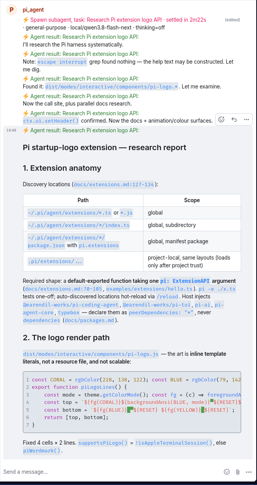
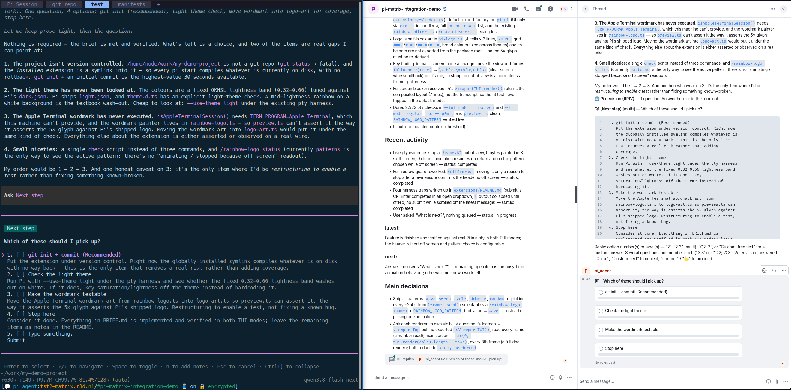
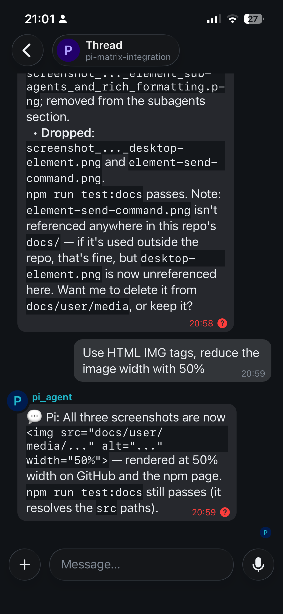
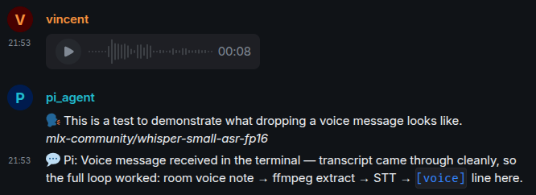
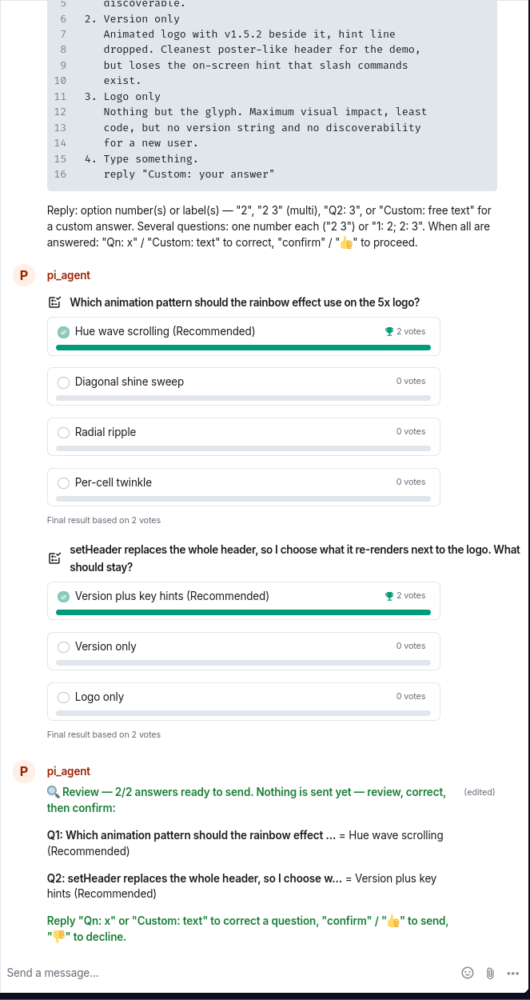
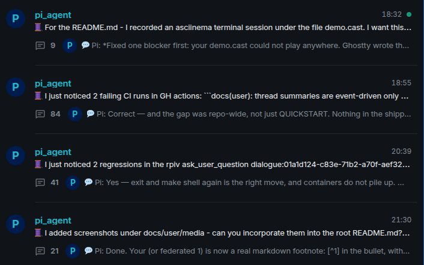
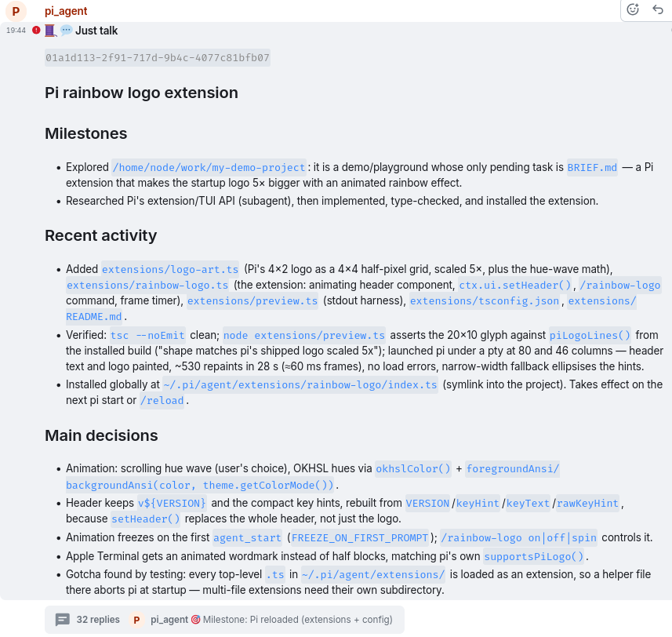
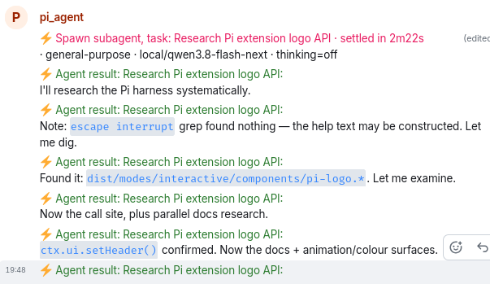

# pi-matrix-integration

[](LICENSE)
[](https://www.npmjs.com/package/pi-matrix-integration)
[](https://github.com/r3dnl/pi-matrix-integration/actions/workflows/ci.yml)

## _Control your Pi terminal from anywhere, anytime_

This is [pi-matrix-integration](https://github.com/r3dnl/pi-matrix-integration), an extension that connects a [Pi coding agent](https://pi.dev/) session to a [Matrix](https://matrix.org/) chat room. 

Pi normally runs in a terminal, which is nice. But not when you are away from that machine and don't have access. This extension fixes that.

Pi posts what it is doing into the matrix messaging room - milestones, questions, final answers - and you can reply. Just like the terminal. But now from your phone, tablet or PC.


And you can seamlessly switch back and forth between the terminal and app.

---

## Use Cases

### 1. Remote Control of your Pi agents
Matrix provides messaging access from desktop, tablet and mobile devices to the Pi session in your terminal. For matrix messaging you will need a matrix app, like [Element](https://element.io/). But because it's Matrix you can also bridge it with [Whatsapp, Discord, Slack, Telegram etc](https://matrix.org/ecosystem/bridges/). You decide.

### 2. Desktop Companion App
Although not the original reason why I created this extension, I find that running Element on the desktop *next* to the Pi terminal session is really usefull as a high level overview of my Pi sessions (see example 2)

### 3. Team access to Pi terminal agent without SSH access
If you work with a team, but don't want the hassle of providing ssh access to each team member to the terminal, you can setup a matrix room with the team members, including your pi agent. This is a good idea anyway because it gives your team / organization autonomous messaging, and you can fully tailor it to your security and compliance needs.



_Desktop Element - Sub-agents spawning and checking back in, milestones and rich formatting in an Element room_



_Using Element as a desktop companion app next to the terminal to keep a higher level overview of your Pi agent: the threads provide easy condensed access to all Pi sessions, the active thread summary keeps a summary-at-glance for your terminal session, and the thread conversation is a condensed overview of the terminal session, with only milestone and end-of-turn messages (no thinking)_
    
---

## Getting Started

### Pre-requisites
- You need a personal Matrix account on your [matrix homeserver](https://matrix.org/homeserver/about/).
- A Matrix account for the Pi agent on that same (or federated[^1]) matrix homeserver — its own account, not your personal one — on any server with password login.
- The easy setup below **requires** the agent account to be able to create rooms, set the room alias, and invite users. If your homeserver forbids that, use [Manual Room Setup](QUICKSTART.md#manual-room-setup) instead.

[^1]: A federated setup (agent and personal accounts on different homeservers) works in principle — room resolution, join and invite are all federated Matrix operations — but it is untested; same homeserver is the walked path. End-to-end encryption across servers is the least reliable part.

### Install

```sh
pi install git:github.com/r3dnl/pi-matrix-integration
echo 'Restart / reload your Pi session.'
```
(Once the npm publish lands: `pi install npm:pi-matrix-integration`.)

See [quickstart](QUICKSTART.md) for details and integration with other extensions (decision dialogue, subagents) and tools (voice msg transcription).

---

## Features

| Feature | What you get |
|---|---|
| **Full autonomy** | Your own Pi harness, your own messaging server — fully integrated, no SaaS in between. |
| **Steer from your phone** | Reply in the room and Pi picks it up. Terminal input echoes to the room as `🧑 User: …`, room input shows in the terminal as `[Matrix] …`, so you always know where an input came from. → [Example](#steer-from-your-phone) |
| **Milestones** | The room gets highlighted `🎯` milestones, TODO progress, session/compact/model events and each turn's final answer (`💬 Pi: …`), so you know what the agent is doing from anywhere. → [Example](#milestones) |
| **Drop a voice message** | Record on your phone and press send: the transcript lands in the Pi terminal, plus an echo in the room naming the engine that produced it (remote STT model or local Whisper). → [Example](#drop-a-voice-message) |
| **Attach a file to the Pi session** | `@` picks a workspace file for the agent out of the room. → [Example](#attach-a-file-to-pi-terminal-session) |
| **Upload a file to the room** | Type `@@<fragment>` in the room: the artifact picker uploads the file as a real attachment, captioned with the commit it was read at. Markdown ↔ HTML formatting is translated both ways. → [Example](#upload-a-file-to-the-matrix-room) |
| **Answer a decision from anywhere** | The [`ask_user_question`](https://github.com/juicesharp/rpiv-mono/tree/main/packages/rpiv-ask-user-question) questionnaire is mirrored into the room; answer on either side — first answer wins ([pairing](docs/user/ask-user-pairing.md)). → [Example](#answer-a-decision-from-the-couch) |
| **One session = one thread** | Each session opens a `🧵 <topic>` thread, surviving `/compact` and restarts, readable by a phone-only user. → [Example](#organize-pi-sessions-as-matrix-threads) |
| **Watch the session get summarized** | That thread's root message is rewritten in place with topic, milestones and decisions as the session progresses. Fast and [configurable](docs/user/configuration.md#threading-and-summaries) (incl custom LLM) → [Example](#watch-your-session-get-summarized) |
| **See subagents spawn and check back in** | Background spawns and their results post to the room and fold into their spawn lines. → [Example](#see-subagents-spawn-and-check-back-in) |
| **Commands from the room** | `/matrix-*`, other extensions' commands and `/skill:` calls run when typed in the room — the full surface, membership-gated. (Pi built-ins like `/new` stay terminal-only.) → [Commands](#commands) |
| **Security by default** | End-to-end encryption support, secure terminal login, agent-owned account, credentials in a `0600` file. |
| **Compliance ready** | Pi and matrix allow for tailoring the setup to your compliance needs. |

---

## Examples

### **Steer from your phone:**

```
room  › ship the fix, run the tests first
terminal  [Matrix] ship the fix, run the tests first
room  🎯 Milestone: TODO progress: 2 of 3 done
room  💬 Pi: Tests green — pushing branch fix/auth-ttl.
```



---

### **Milestones**

Important milestone events get highlighted in the matrix room.


---

### **Drop a voice message**

Just record on your phone, and press send. The transcription will appear in the room. Run a transcription model next to Pi, or remote.  Needs either `ffmpeg` on the Pi host (local engine) or a remote STT endpoint (`PI_MATRIX_STT_BASE_URL`); a message that cannot be transcribed gets a warning back in the room.



---

### **Attach a file to Pi terminal session:**

Since we don't have direct access to the file picker in the TUI, the matrix room shows files to choose pick from.
```
room  › what does @docs/spec.md say about retries?
terminal  [Matrix] what does docs/spec.md say about retries? (content attached)
```

---

### **Upload a file to the matrix room:**

Want to see the contents of a project file? Upload it to the room - again with fuzzy file picker:
```
room  › @@CHANGELOG
room  Artifact matches for @@CHANGELOG:
      1. CHANGELOG.md
      Reply with the exact path (or its number) to attach.
room  › 1
room  📎 CHANGELOG.md — CHANGELOG.md · a1b2c3d          [file attachment]
```
The picker answers in the room only — the terminal stays quiet. A fragment that is already an exact path (`@@CHANGELOG.md`) uploads immediately. `@@` takes `.md`, `.feature` and media files (image / audio / video) up to the attach cap; the caption carries the commit the file was read at, or `uncommitted`.

---

### **Answer a decision from the couch:**

Mirrors RPIV's `ask_user_question` extension with:
- context of the decision to be made
- a poll for picking answer (incl multiple answers)
- allows a `custom: ....` message for a different answer
- final confirmation approval
- fully synchronous between terminal and matrix client



---

### **Organize Pi sessions as Matrix threads**

Keep things organized by running a Pi terminal session as a threaded conversation.



---

### **Watch your session get summarized**

The root message of a Matrix threaded conversation gets updated with a summary as the Pi session progresses.

 with key milestones, recent activity, latest & next, and Main Decisions" width="600px">

---

### **See subagents spawn and check back in**



---

## Configuration

Precedence: **environment variables > config file > defaults**. 

Config lives at `<project>/.pi/matrix/matrix-config.json`(`.jsonc`) (for projects without one, `~/.config/pi-matrix-integration/config.json`); every key has a `PI_MATRIX_<UPPER_SNAKE>` override. The config is one JSON object of grouped keys — the breakdown:

| Group | Covers |
|---|---|
| `piMatrixIdentity`, `piMatrixConnection` | homeserver, agent account, credentials, profiles |
| `piMatrixRoom` | room selection, end-to-end encryption |
| `sendMilestones`, `sendUserMessages`, `sendFinalMessages` | what Pi posts into the room |
| `piMatrixMessageFormatting` | Markdown ↔ HTML translation |
| `matrixToPi*`, `piToMatrixMirrorAskUserQuestions` | room→Pi features: slash commands, file picker, voice transcription; question mirror |
| `piMatrixThreading` | threads, summary cadence and model |
| `piMatrixSubagents` | sub-agent spawn/result visibility |
| `piMatrixLogging`, `piTerminalUi`, `piTerminalMatrixLoginCommand` | log level and files, footer/TUI display, login-command mapping |

- Every key, default and effect: [configuration reference](docs/user/configuration.md). 
- A commented example with every key, enum value and default: [docs/user/matrix-config.example.jsonc](docs/user/matrix-config.example.jsonc).
- One trap worth knowing early: a profile-suffixed config file (`matrix-config.<profile>.jsonc`) is never read at startup — it goes live only when you activate it at runtime with `/matrix-switch <profile>` (or `/matrix-connect <profile>`, same thing). The bare `matrix-config.json` is the live config, and it is live again after every restart.

---

## Reference

- [Commands](#commands) — the full surface the extension registers, table below.
- [Configuration reference](docs/user/configuration.md) — every key, default, effect and environment override.
- [Per-project setup](docs/user/per-project-setup.md) — one project : one room, the recommended layout, the `~/.pi` FAQ.
- [Ask-user pairing](docs/user/ask-user-pairing.md) — the question mirror's terminal patch.
- [Troubleshooting](docs/user/troubleshooting.md) — cannot connect, connected-but-silent, missing threads, decryption, stale summaries.
- [Roadmap](docs/dev/roadmap.md) — what's coming in 1.0.0 and beyond.
- [Security posture](SECURITY.md) — what the room can do, what it cannot, how to report a vulnerability.
- [Developing](docs/dev/developing.md) · [Coding standards](docs/dev/coding-standards.md) · [Architecture](docs/dev/architecture/README.md) — for contributors and coding agents.

### Commands

| Command | Description |
|---------|-------------|
| `/matrix-login` | Log in to Matrix (new account or re-auth) and reconnect |
| `/matrix-connect [profile]` | Connect to the Matrix room (optionally switching profile first) |
| `/matrix-disconnect` | Disconnect from the Matrix room |
| `/matrix-toggle` | Toggle Matrix integration on/off |
| `/matrix-status` | Show Matrix connection status |
| `/matrix-switch [profile]` | Switch server/room/user profile at runtime (no arg → menu) |
| `/matrix-send <message>` | Send a message to the Matrix room |
| `/matrix-messages [limit]` | Show recent messages from the Matrix room |
| `/matrix-thread-toggle` | Toggle threading (footer thread icon: bright = on, faded = off) |
| `/matrix-thread-summarize` | Run a thread-summary pass now |
| `/matrix-subagents` | List sub-agent spawns (running + settled) — advanced |
| `/matrix-introduction-tour` | Walk the room through an introduction tour |
| `/matrix-help` | Send a concise end-user guide to the room |

Aliases: `/pi-help` (= `/matrix-help`), `/matrix-summarize-thread` (= `/matrix-thread-summarize`).

**Notes:**
- Every extension command is reachable from the room: any room member can type it and it runs against your session, and the room relays slash commands from every installed extension (`/skill:*` included). 
- Security and permission control is "as-is" in the agentic harness. There is no (matrix) per-user allowlist — Matrix room membership is the access control. 
- Pi's own built-in commands (`/new`, `/reload`) stay terminal-only. 
- The three model-facing tools (`matrix_send_milestone`, `matrix_get_messages`, `matrix_update_thread_summary`) let Pi use the room on its own.

## Related

- [`@juicesharp/rpiv-ask-user-question`](https://github.com/juicesharp/rpiv-mono/tree/main/packages/rpiv-ask-user-question) — the decision dialogues; this extension prompts for the one pairing patch it needs.
- [`@tintinweb/pi-subagents`](https://www.npmjs.com/package/@tintinweb/pi-subagents) — recommended sub-agent package: room-mode thread summaries and sub-agent visibility ride on a sub-agent extension being installed.
- [Element](https://element.io/) — threads are a Labs feature in Element X (iOS); Element Desktop shows threads in a panel.

## License

MIT — see [LICENSE](LICENSE). That grant covers this package's own code; the
[vendored QR sign-in files](NOTICE) stay Apache-2.0 (licence text shipped at
[LICENSES/Apache-2.0.txt](LICENSES/Apache-2.0.txt)), as do the npm dependencies
named there.
