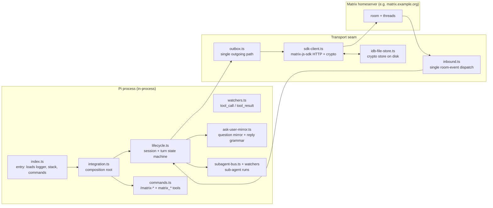

# Architecture

This tree describes how `pi-matrix-integration` is built and why it is built that way. It is derived from the code that ships, so where it disagrees with the code, the code is right and this is a bug.

Read the map here first. Each topic below is a separate document; nothing here is deeper than three levels.

## What the extension does

One Pi session in a project directory is mirrored into one Matrix room. Outbound: milestones, TODO progress, session events and each turn's final answer. Inbound: replies from the room reach the agent, and decision questions can be answered on either surface. Each session gets its own conversation thread inside the room, and that thread's root message carries a running summary.

## The shape, in one picture

Two rules hold that picture together, and most of the design follows from them:

- **One identity, one writer.** One Matrix account per Pi instance, and exactly one component owns the outgoing connection. Everything that wants to say something goes through `src/outbox.ts`; nothing else opens a second client. The reasoning is in [transport and state](transport-and-state.md).
- **An event bus, not cross-imports.** Pi's lifecycle and tool events arrive through `pi.on(...)` subscriptions wired in `src/integration.ts`. Modules talk to each other through `src/events.ts`, the domain-event dispatcher, rather than by importing each other. That is what keeps `src/lifecycle.ts` testable.

## Where the responsibilities live

| Area | Module | Owns |
|------|--------|------|
| Wiring | `src/integration.ts` | builds the stack, subscribes the 13 Pi lifecycle and turn events, resolves config at startup |
| Session model | `src/lifecycle.ts` | what a session, a turn and a summary pass are; what may be sent when |
| Inbound | `src/inbound.ts` → `src/message-handler.ts` | the single dispatch point for room events, and their translation into agent input |
| Outbound | `src/outbox.ts` → `src/sdk-client.ts` → `src/markdown.ts` | one write path, Markdown to HTML, dedupe, rate limits |
| Identity | `src/login.ts`, `src/qr2025/` | credential storage, sign-in dialogue, sign-in-with-QR |
| E2EE | `src/sdk-client.ts`, `src/idb-file-store.ts`, `src/encryption-status.ts` | device keys, room keys, attachment decryption |
| Threads | `src/threading.ts`, `src/thread-meta.ts` | session-to-thread mapping, thread roots, sub-threads |
| Summaries | `src/summarize.ts`, `src/summarize-dispatch.ts`, `src/subagent-summarizer.ts`, `src/classify.ts` | cadence, prompts, which runner computes a summary, loop guards |
| Decisions | `src/ask-user-mirror.ts` | mirroring a Pi questionnaire into the room and reconciling whichever answer lands first |
| Room behaviour | `src/room-ux.ts`, `src/command-relay.ts`, `src/file-attach.ts`, `src/artifact-attach.ts`, `src/voice.ts`, `src/tui-footer.ts` | attach protocols, slash relay, footer status |
| Sub-agents | `src/subagent-bus.ts`, `src/subagent-provider.ts`, `src/subagent-providers/` | reporting delegated runs into the room, across provider dialects |
| Configuration | `src/config-utils.ts`, `src/config.ts`, `src/types.ts` | resolution order, the v2 schema, migration |

## Topics

| Document | Covers |
|----------|--------|
| [Transport, identity and state](transport-and-state.md) | the single-writer rule, the Outbox seam, crypto and the vendored MSC4388 code, where state lives on disk |
| [Threads and summaries](threads-and-summaries.md) | session-to-thread mapping, lazy thread creation, summary cadence, and the two loop guards that came out of a runaway-summary incident |
| [Configuration](configuration.md) | config resolution order, profiles and where credentials live |
| [Room behaviour](room-behaviour.md) | how the room drives the agent, the questionnaire mirror, sub-agent provider dialects, security posture, command-surface rules |
| [Design principles](DESIGN-PRINCIPLES.md) | the cross-cutting rules: one writer, soft failure, the room as boundary, echo isolation, declare-don't-detect, turn-scope decisions, background channels, never go silent |

## Trust boundary in one paragraph

Anything posted in a connected room becomes model input, and every registered command is reachable from the room — including `/skill:` invocations and other extensions' commands. The room's membership list is therefore the security boundary: use an invite-only room and give the agent its own account. `SECURITY.md` states the same thing with the full dependency list; the code-level verification is `test/security-boundary.mjs`.

## How to use this tree when changing code

1. Find the area in the table above, then open the module.
2. Read the topic document for the invariant you might be about to break — the "why" is written next to the invariant, not in a separate spec.
3. If your change crosses two topics, it probably crosses a seam. That is a signal, not a prohibition.
