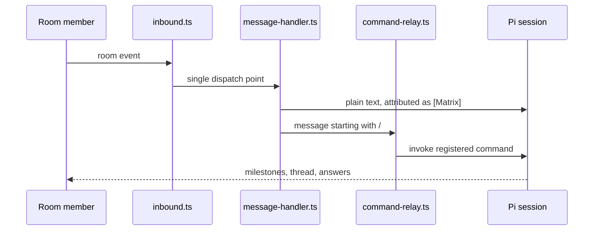

# Room behaviour

Covers: how the room drives the agent, how answers to questions come back
from the room, how sub-agent runs are reported, and where the security
boundary sits. How the extension finds its config and how profiles work is
[configuration](configuration.md).

## How the room drives the agent

Four behaviours are worth knowing before you change anything here:

- **Attribution is not optional.** Anything that came from the room is marked `[Matrix]` in the terminal, so a session transcript always shows where input originated. `isPiMachineTraffic` in `src/message-handler.ts` keeps the extension from reading its own postings as user input.
- **Slash relay.** A room message that starts with `/` is offered to Pi's command registry, which means skills and other extensions' commands are reachable from the room. See the security note below.
- **Attach protocols.** `@` picks a file for inline inclusion (`src/file-attach.ts`, prefixes `PI_MATRIX_FILE_ATTACH_PREFIX` and `PI_MATRIX_FILE_PICKER_PREFIX`), `@@` attaches an artifact produced by the session (`src/artifact-attach.ts`). Two prefixes because two different intents.
- **Footer state.** `src/tui-footer.ts` shows connection status, the homeserver and the room, and whether threading is on, so the terminal always tells you what the extension believes.

## Answering questions from the room

`src/ask-user-mirror.ts` mirrors Pi's `ask_user_question` questionnaire into the thread and reconciles the answer, whichever surface completes first. The reply grammar is deliberately small: option numbers, `Custom: …` for free text, 👍/👎 for yes-no, and a review step that echoes what will be submitted before it is submitted. The mirror's state is flushed at `message_end` so a question cannot stay open in the room after the terminal has moved on.

Race semantics are part of the contract: the first complete answer wins, the losing surface is told it lost, and a partial answer never overrides a complete one.

## Sub-agent reporting

Delegated runs are reported into the thread so a phone user can follow fan-out. The problem is that the sub-agent packages do not agree on tool names or completion notices, so the extension puts a contract in the middle:

| Module | Role |
|--------|------|
| `src/subagent-provider.ts` | the contract: what a spawn looks like, what a completion looks like |
| `src/subagent-providers/` | one adapter per dialect — the `@tintinweb` shape and the `pi-subagents` shape |
| `src/subagent-providers/resolve.ts` | auto-detection: it tries a dialect and binds the one that actually answered, then tells you to set `subagents.provider` explicitly if you want determinism |
| `src/watchers.ts` | normalises `tool_call` / `tool_result` into spawn and identity records |
| `src/subagent-bus.ts` | posts the normalised records into the room, assigning palette colours |

Nothing here requires a sub-agent package. Without one, the features that need a spawn degrade — thread summarisation falls back to its in-session path, as described in [threads and summaries](threads-and-summaries.md).

## Security posture

Anything posted in a connected room becomes model input, and every registered command — including `/skill:` and other extensions' commands — is reachable from the room by any room member. There is no per-message authorisation in the Matrix client-server API that could narrow this, so:

- the room's **membership list is the security boundary**: invite-only, and the agent gets its own account, never yours;
- the relay adds no execution power of its own — it calls Pi's own command registry and must not skip Pi's own confirmation for anything that mutates your working tree. `test/security-boundary.mjs` asserts that, and `SECURITY.md` states the consequence in user terms.

The same document carries the dependency inventory and the disclosure contact.

## Rules that govern the command surface

When a `/matrix-*` command is added, renamed or removed, these three rules decide it:

1. The configuration file is the leading, declarative description of extension behaviour.
2. `/matrix-*` commands invoke functionality — they are not a place to store a preference.
3. Anything you need while away from the terminal must be reachable from the room, so it must exist as a command.

Rule 1 and rule 2 are why toggling behaviour at runtime and configuring it permanently are different surfaces. The redesign issue tracks the places where the current commands violate them.
