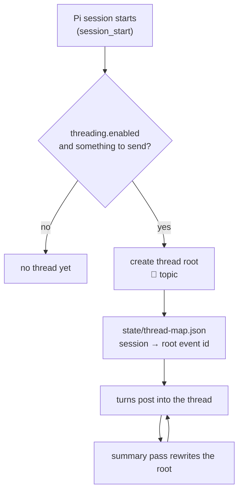

# Threads and summaries

Covers: how a Pi session maps to a Matrix thread, when a summary is computed, who computes it, and the guards that stop a summary from causing more summaries.

## Entity mapping

| Concept | Matrix object |
|---------|---------------|
| One project (its Pi harness and history) | one room |
| One Pi session in that project | one thread, rooted at its own message |
| The running account of that session | the thread's **root message**, rewritten in place |
| Room mainline | milestones and session events only — never summary text |

The room is the project's persistent record; the thread is one session inside it. Rewriting the root message rather than posting new ones is what keeps a room readable while still giving a phone-only user a current summary. `src/threading.ts` owns all of it; `src/thread-meta.ts` normalises the incoming thread metadata so the rest of the code does not parse raw events.

Threads are created lazily. A session that never sends anything to the room does not root a thread, so abandoned or non-matrix sessions leave no empty thread behind. The mapping survives restarts in `state/thread-map.json`.

## When a summary runs

The cadence is configuration, not code: `piMatrixThreading.summaryCadence` counts HUMAN messages — terminal input and room relays only (PROP-001 P2). The extension's own output (milestones, report-outs, the summary root itself) advances no meter: `ThreadManager.recordHumanMessage()` is the only thing that ticks it, so a pass can never extend or re-arm its own cadence. `useFibonacciCadence` switches the spacing to a Fibonacci progression so early messages are summarised more often than late ones. `summarizeOnFinalMessage` triggers a pass on the turn's final answer, gated on the same human meter. Size is bounded per pass by `summarizeLimit`, `summarizeMilestoneMax`, `summarizeRecentMax` and `summarizeMaxLines`, with a wall-clock ceiling in `summarizeRunTimeoutMs`.

All of it is off unless you turn it on: `piMatrixThreading.enabled` is the master gate, and `/matrix-threads`-style toggles flip it at runtime.

## Who computes it

`src/summarize-dispatch.ts` decides the runner from one key, `summarizeSource`:

| Value | Delta it summarises | Runner | Posts via |
|-------|--------------------|--------|-----------|
| `"room"` (default) | the thread's own Matrix messages | the isolated `pi-matrix-integration-thread-summarizer` sub-agent when a sub-agent provider is installed; otherwise an in-session directive | sub-agent calls `updateSummary` directly; in-session path calls the `matrix_update_thread_summary` tool |
| `"session"` | the main Pi session's own context | the main session itself — no spawn, no context copy, no room read | the `matrix_update_thread_summary` tool |

The in-session tool is the reason the extension owns the summary's shape: the tool implementation prepends the `🧵 {topic}` line itself, so a model cannot forget the marker and break the root message's structure.

`useLlmForSummaries` selects between a model-written summary and a deterministic digest, and `summarizeModel` names the model. **If that model is unreachable, the pass fails and the previous summary stays.** Nothing is posted and the room keeps the last good summary — which is the safe direction, but it also means a misconfigured or offline model produces a silent gap rather than an error in the room. Check the error log when summaries stop appearing.

`agents/pi-matrix-integration-thread-summarizer.md` is the sub-agent definition. It is deliberately tool-less: it receives a baseline summary plus the newest messages and returns text. It carries no model pin — the model comes from configuration at spawn time.

## Two loop guards

The summarizer fires when a thread has seen enough activity — and a
summary is itself activity in that thread. Left unguarded, one pass
writes output that reads like fresh input, which fires the next pass,
which writes again: the loop feeds itself and never stops. Two guards
make that impossible, and both must survive any refactor:

1. **A pass must never re-arm itself.** The cadence gate and the content
   gate read only `humanMsgCount`, which
   `ThreadManager.recordHumanMessage()` advances — called solely from
   the human-input branch of `onMessageEnd` in `src/lifecycle.ts`. Own
   sends cannot tick it, so summary output cannot arm the next pass.
   Separate from the guards, a broadcast filter —
   `summaryTriggerRun && !humanInputPending` in `onTurnEnd` — keeps a
   pure-summary turn's chatty closing line out of the room. It is
   presentation only; it carries no loop-prevention duty.
2. **Directive kind is explicit.** A summary request is a typed
   directive, not free text that happens to mention summarising, so it
   cannot be provoked by room content that discusses summaries.

`test/offline/summarizer-wake.mjs` covers this area. If you touch
`lifecycle.ts` or `classify.ts`, run them.

## What survives what

Pi tells the extension why a session started — `startup`, `new`,
`reload`, `resume` or `fork` (`src/threading.ts`) — and each reason has
its own thread behaviour. Compaction is not a session start at all.

| Event | New session? | New thread? | Behaviour |
|-------|--------------|-------------|-----------|
| Fresh Pi start (`/pi quit`, then start Pi again) | yes | yes — on the first user message | `startup`: no traffic yet, the "Pi session started" milestone lands flat in the room; the first user message opens a fresh thread |
| `/new` | yes | yes — on the first user message | same as a fresh start: the old thread belongs to the old session |
| `/reload` | no | no | the session keeps its id, so it re-attaches from `state/thread-map.json` to the thread mapped to *this* session — never to another session's thread. A session that has not opened a thread yet (`/new`, then `/reload`) opens its own on the first message |
| resume / fork of an older session | re-attached | the old one | the recorded session id is looked up in `state/thread-map.json` and its thread re-attached; an unknown id behaves like a fresh start |
| `/compact` | no | no | the thread mapping and the last summary are on disk, so the summary continues from the root message, not from the compacted context |
| Summary pass failure | — | — | the previous root text is left in place |
| Room sourced with no sub-agent provider | — | — | the in-session directive path runs; a warning is logged the first time |

## Invariants to keep

1. The room mainline never carries summary text.
2. Summary output cannot cause another summary.
3. A failed summary keeps the last good one.
4. The thread root's structure (`🧵 topic`, sections) is enforced by code, not by the model's good behaviour.
5. One session keeps one thread — across `/compact`, `/reload` and
   resume. A fresh thread belongs to a fresh session, never to one that
   already has a thread.
