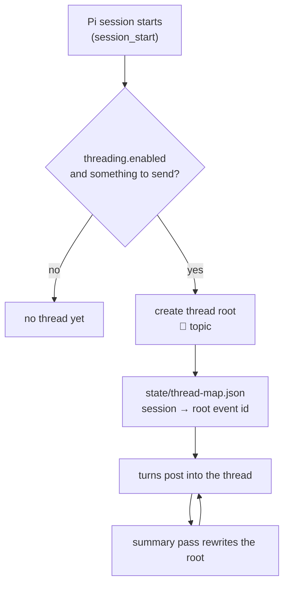

# Threads and summaries

Covers: how a Pi session maps to a Matrix thread, when a summary is computed, who computes it, and the guards that stop a summary from causing more summaries.

## Entity mapping

| Concept | Matrix object |
|---------|---------------|
| One project (its Pi harness and history) | one room |
| One Pi session in that project | one thread, rooted at its own message |
| The running account of that session | the thread's **root message**, rewritten in place |
| Room mainline | milestones and session events only — never summary text |

The room is the project's persistent record; the thread is one session inside it. Rewriting the root message rather than posting new ones is what keeps a room readable while still giving a phone-only user a current summary. `src/threading.ts` owns all of it; `src/thread-meta.ts` normalises the incoming thread metadata so the rest of the code does not parse raw events.

Threads are created lazily. A session that never sends anything to the room does not root a thread, so abandoned or non-matrix sessions leave no empty thread behind. The mapping survives restarts in `state/thread-map.json`.

## When a summary runs

The cadence is configuration, not code: `piMatrixThreading.summaryCadence` counts HUMAN messages — terminal input and room relays only (PROP-001 P2). The extension's own output (milestones, report-outs, the summary root itself) advances no meter: `ThreadManager.recordHumanMessage()` is the only thing that ticks it, so a pass can never extend or re-arm its own cadence. `useFibonacciCadence` switches the spacing to a Fibonacci progression so early messages are summarised more often than late ones. `summarizeOnFinalMessage` triggers a pass on the turn's final answer, gated on the same human meter. Size is bounded per pass by `summarizeLimit`, `summarizeMilestoneMax`, `summarizeRecentMax` and `summarizeMaxLines`, with a wall-clock ceiling in `summarizeRunTimeoutMs`.

All of it is off unless you turn it on: `piMatrixThreading.enabled` is the master gate, and `/matrix-threads`-style toggles flip it at runtime.

## Who computes it

`src/summarize-dispatch.ts` decides the runner from one key, `summarizeSource`:

| Value | Delta it summarises | Runner | Posts via |
|-------|--------------------|--------|-----------|
| `"room"` (default) | the thread's own Matrix messages | the isolated `pi-matrix-integration-thread-summarizer` sub-agent when a sub-agent provider is installed; otherwise an in-session directive | sub-agent calls `updateSummary` directly; in-session path calls the `matrix_update_thread_summary` tool |
| `"session"` | the main Pi session's own context | the main session itself — no spawn, no context copy, no room read | the `matrix_update_thread_summary` tool |

The in-session tool is the reason the extension owns the summary's shape: the tool implementation prepends the `🧵 {topic}` line itself, so a model cannot forget the marker and break the root message's structure.

`useLlmForSummaries` selects between a model-written summary and a deterministic digest, and `summarizeModel` names the model. **If that model is unreachable, the pass fails and the previous summary stays.** Nothing is posted and the room keeps the last good summary — which is the safe direction, but it also means a misconfigured or offline model produces a silent gap rather than an error in the room. Check the error log when summaries stop appearing.

`agents/pi-matrix-integration-thread-summarizer.md` is the sub-agent definition. It is deliberately tool-less: it receives a baseline summary plus the newest messages and returns text. It carries no model pin — the model comes from configuration at spawn time.

## Two guards, both learned the hard way

An October 2026 incident put the extension into a loop where summary output re-triggered summarisation until the session was unusable. Two guards exist because of it, and both must survive any refactor:

1. **A pass must never re-arm itself.** Structural since PROP-001 P2/P3: the cadence gate and the content gate read `humanMsgCount`, which only `ThreadManager.recordHumanMessage()` advances — called solely from the human-input branch of `onMessageEnd` in `src/lifecycle.ts`. Own sends cannot tick it, so summary output cannot arm the next pass. The sink-side patch this replaced (recognising summarizer-started runs and muting their broadcasts) survives only as a broadcast filter — `summaryTriggerRun && !humanInputPending` in `onTurnEnd` keeps a pure-summary turn's chatty closing line out of the room — with no loop-prevention duty on it.
2. **Directive kind is explicit.** A summary request is a typed directive, not free text that happens to mention summarising, so it cannot be provoked by room content that discusses summaries.

`test/summarizer-wake.mjs` and `test/bug-summarizer-onfinal-loop.mjs` cover this area. If you touch `lifecycle.ts` or `classify.ts`, run them.

## What survives what

| Event | Behaviour |
|-------|-----------|
| `/compact` | the thread mapping and the last summary are on disk, so the summary continues from the root message, not from the compacted context |
| Pi restart | `state/thread-map.json` reattaches the session to its thread; a reload must not hijack a previous session's thread |
| Summary pass failure | the previous root text is left in place |
| Room sourced with no sub-agent provider | the in-session directive path runs; a warning is logged the first time |

## Invariants to keep

1. The room mainline never carries summary text.
2. Summary output cannot cause another summary.
3. A failed summary keeps the last good one.
4. The thread root's structure (`🧵 topic`, sections) is enforced by code, not by the model's good behaviour.
5. One session keeps one thread across compact and restart.
