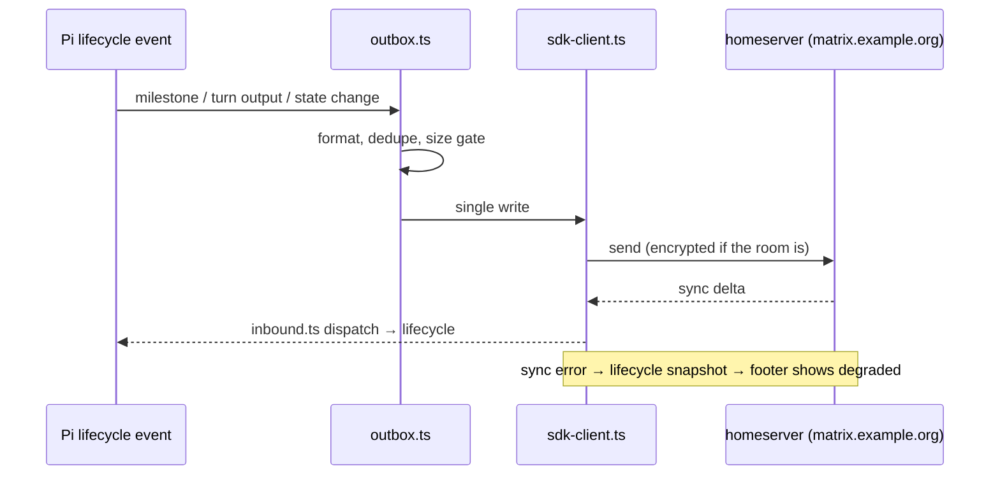

# Transport, identity and state

Covers: how the extension talks to a homeserver, why only one component may do it, how encrypted messages are handled, and what is written to disk.

## The two transports, and why there is now one

The extension originally drove an external `mtx` command-line client through a shell. That path is gone: `src/sdk-client.ts` runs `matrix-js-sdk` over HTTP inside the Pi process, and `src/outbox.ts` is the seam both the old and new design had to pass through.

The seam is the point. Anything that wants to say something — a milestone, a footer state, a summary rewrite — hands a message to the Outbox. The Outbox owns:

- formatting, through `src/markdown.ts` (Markdown to the HTML Matrix renders),
- deduplication within a configurable window (`PI_MATRIX_DEDUPE_WINDOW_MS`),
- size limits (`PI_MATRIX_MAX_FINAL_MESSAGE_LENGTH`, `PI_MATRIX_MAX_BYTES_UPLOAD`),
- the single connection, so ordering is defined.

**Invariant: one Matrix identity, one writer.** A second client with the same device would race the first over state and produce duplicate or out-of-order messages. If you need to emit something, add a method to the Outbox; do not open a client.

The sync loop's errors are surfaced instead of swallowed: `src/sdk-client.ts` wires a sync-error feed into the lifecycle snapshot, so the footer shows a degraded connection rather than pretending to be healthy.

## Soft failure

A Matrix outage must not stop you coding. Every outbound path degrades: connection problems show in the TUI footer (`src/tui-footer.ts`) and in the error log (`src/logger.ts`), and the session continues. On the inbound side the same principle holds — an event the extension cannot handle is logged and skipped, never thrown into Pi's event loop.

## End-to-end encryption

`matrix-js-sdk` performs the crypto; the extension supplies two pieces it needs in a headless process.

- **Crypto store.** A browser IndexedDB is not available, so `src/idb-file-store.ts` implements the IndexedDB surface over files on disk. Its location is configurable through `PI_MATRIX_CRYPTO_STORE_DIR`. The store is separated per account and homeserver, so two environments cannot cross-write keys into each other's store.
- **Sign-in with QR (MSC4108 / MSC4388).** `src/qr2025/` is vendored code from a `matrix-js-sdk` pull request, copyright The Matrix.org Foundation C.I.C., Apache-2.0, headers intact. `NOTICE` records the provenance. Its own header carries a `KNOWN GAP`: the secure channel needs `HpkeRecipientChannel` from `@matrix-org/matrix-sdk-crypto-wasm`, which upstream had not published when the copy was taken. `tools/check-vendored.mjs` tests whether the installed SDK now exports what MSC4388 needs — weekly in the Nightly workflow, on demand locally; when it fires, delete `src/qr2025/` and keep only the attribution. Treat those three files as read-only until that day.
- **Encrypted attachments** go through `matrix-encrypt-attachment`, gated by `PI_MATRIX_ATTACH_ENCRYPTION`.
- Room encryption state is a vocabulary in `src/encryption-status.ts`, so the UI can say "this room is not encrypted" without inventing its own wording.

## What lives on disk

Everything the extension remembers is in its `state/` directory, which is gitignored and machine-local by design.

| File | Written by | Contents |
|------|-----------|----------|
| `state/thread-map.json` | `src/threading.ts` | session-to-thread mapping, thread roots and their summary state |
| `state/unread-<homeserver>.json` | `src/unread-model.ts` | per-room read markers and thread previews; `apiVersion` is `pi-matrix/v1` |
| `state/sdk-seen-<homeserver>.json` | `src/sdk-client.ts` | event ids already processed, so a restart does not replay the room |
| `state/project-room-manifest.json` | project room resolution | which room belongs to this project |

Reads are tolerant: `UnreadModel` returns an empty model for a missing or corrupt file rather than throwing, because losing a read marker must not stop a session. Writes are atomic where they matter — if you add a state file, write to a temporary file and rename.

Credentials are separate from state and separate from config: `~/.config/mtx/projects/<project>/accounts/<user>--<domain>/credentials.json`, path built by `getProjectCredentialsPath`, file mode `0600`. Never log their contents, and never echo them in a tool result.

## Invariants to keep

1. One identity, one writer, one Outbox.
2. Transport failure degrades the UI; it never throws into Pi's event loop.
3. State reads tolerate absence and corruption; state writes are atomic.
4. Secrets are read from the credential file or the environment, never from a shipped manifest.
5. Vendored crypto code is not edited — it is deleted when upstream ships the feature.
