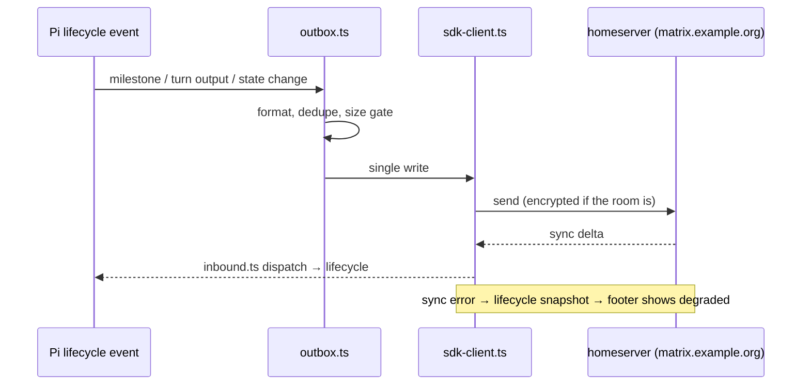

# Transport, identity and state

Covers: how the extension talks to a homeserver, what identity means in
Matrix and how the extension obtains and keeps one, how room encryption
keys are stored, and what is written to disk.

## The transport chain

Three parties sit in a line: your Pi session, the extension, and the
Matrix homeserver.

```text
Pi session  <->  extension (this repo, in-process)  <->  homeserver (HTTPS)
```

Pi and the extension live in the same process: Pi hands the extension
lifecycle events (a turn ended, a tool ran), and the extension posts the
results. Between the extension and the homeserver runs the Matrix
client-server API over HTTPS, driven by `matrix-js-sdk`, loaded inside
the Pi process by `src/sdk-client.ts`.

The SDK owns everything that speaks Matrix: the HTTP calls, the login
API, the sync loop, and end-to-end encryption. The extension owns the
decisions around it: what to say, when to say it, and what to do when the
SDK fails (the soft-failure rule below). Two paths cross that border, one
in each direction:

- **Writes** go through `src/outbox.ts` — see the next section.
- **Reads** come from the sync loop: `client.startClient()` holds a
  long-poll open (capped by `PI_MATRIX_SYNC_TIMEOUT_MS`) and hands every
  room event to `src/inbound.ts`. The first round — history backfill — is
  baselined and
  never emitted, so joining does not repost the room's past. Event ids
  already processed are recorded in a state file, so a restart does not
  replay the room either.

### The Outbox seam

Anything inside the extension that wants to say something — a milestone,
a footer state, a summary rewrite — hands a message to the Outbox. The
Outbox owns:

- formatting, through `src/markdown.ts` (Markdown to the HTML Matrix renders),
- deduplication within a configurable window (`PI_MATRIX_DEDUPE_WINDOW_MS`),
- size limits (`PI_MATRIX_MAX_FINAL_MESSAGE_LENGTH`, `PI_MATRIX_MAX_BYTES_UPLOAD`),
- the single connection, so ordering is defined.

**Invariant: one Matrix identity, one writer.** A second client with the
same device would race the first over state and produce duplicate or
out-of-order messages. If you need to emit something, add a method to the
Outbox; do not open a client. The same rule runs across processes: a
lockfile (`pi-matrix.lock` in the account directory, holding the owning
pid) lets only one live session hold an account — a second session over
the same device splits the encryption state and breaks decryption (see
the key store below). It fails soft with one clear line.

## Identity and sign-in

A Matrix identity is three facts:

- a **user id** — `@pi_agent:example.org`, assigned by the homeserver;
- a **device id** — every login is a separate "device" (a phone, a
  laptop, a session on your machine). Keys and message history belong to
  a device, so a stable device id is what lets the same session decrypt
  yesterday's messages;
- an **access token** — the secret that proves you. Every API call
  carries it; whoever holds it *is* that device.

**How the token is obtained.** On first run (or `/matrix-login`) the
dialogue in `src/login.ts` asks the homeserver which sign-in methods it
offers (`/_matrix/client/v3/login`):

- **Password**: the extension sends user and password; the server answers
  with a fresh `user_id`, `device_id` and `access_token`.
- **QR (MSC4108/MSC4388)**, behind the `qr2025` toggle and off by
  default: you scan a code with an already-signed-in client, that client
  approves, and the server hands out a token the same way. This path runs
  the vendored `src/qr2025/` code.

**How the token is kept.** The dialogue writes the answer to the
credentials file — `~/.config/mtx/projects/<project>/accounts/<user>--<domain>/credentials.json`,
path built by `getProjectCredentialsPath`, file mode `0600` — holding
`user_id`, `homeserver`, `device_id` and `access_token`. On the next
start, the extension reads that file and connects with the stored token;
the login dialogue only runs when the file is missing or carries no
token. Environment variables (`PI_MATRIX_HOMESERVER`, `PI_MATRIX_USERNAME`,
`PI_MATRIX_PASSWORD`, or a credentials path of your own) override or
supply these values — that is how the live test tier passes credentials
without writing anything into the repo.

A configured `deviceId` in the config wins over the file's `device_id` —
it is an operator override — and the extension warns when the two
disagree, because the homeserver rejects a token used under the wrong
device id with a 400.

## Soft failure

A Matrix outage must not stop you coding. Every outbound path degrades:
connection problems show in the TUI footer (`src/tui-footer.ts`) and in
the error log (`src/logger.ts`), and the session continues. On the inbound
side the same principle holds — an event the extension cannot handle is
logged and skipped, never thrown into Pi's event loop.



The sync loop's errors are surfaced instead of swallowed: `src/sdk-client.ts`
wires a sync-error feed into the lifecycle snapshot, so the footer shows
a degraded connection rather than pretending to be healthy.

## Room encryption and its keys

In an encrypted room, message text travels as ciphertext: the homeserver
relays it but cannot read it. Only the devices in the room hold the keys.
Two kinds are at work:

- **Olm** keys encrypt device-to-device traffic — most importantly, the
  messages that hand out room keys. Each device has Olm identity keys,
  and pairs of devices build shared sessions on first contact.
- **Megolm** keys encrypt the room itself: one sender key per device per
  room. A device encrypts with its own megolm key and shares that key
  with the other devices over the Olm channels above. Decrypting a room
  message therefore needs the key another device sent you — which is why
  losing the key store loses old messages, and why two sessions must not
  use one device at once (the account lock): the Olm ratchet state would
  fork, keys would stop arriving, and the room would fill with "Unable to
  decrypt".

`matrix-js-sdk` performs the crypto itself — `@matrix-org/matrix-sdk-crypto-wasm`,
Rust compiled to WASM, does the math. The SDK expects a browser; the
extension supplies what a headless process lacks:

- **Crypto store.** Browsers keep keys in IndexedDB;
  `src/idb-file-store.ts` implements that surface over files — one JSON
  file per key under `dir/<db>/<store>/`, written atomically. Keys live
  under `PI_MATRIX_CRYPTO_STORE_DIR`, one store per account and
  homeserver so two environments cannot cross-write keys. A configured
  `storePassphrase` (`PI_MATRIX_STORE_PASSPHRASE`) makes the wasm layer
  encrypt the store at rest — the files then hold encrypted blobs only.
  `test/live/sdk-passphrase.mjs` checks the passphrase behaviour by hand.
- **QR sign-in code.** `src/qr2025/` is vendored from a `matrix-js-sdk`
  pull request, copyright The Matrix.org Foundation C.I.C., Apache-2.0,
  headers intact; `NOTICE` records the provenance. Its header carries a
  `KNOWN GAP`: the secure channel needs `HpkeRecipientChannel` from
  `@matrix-org/matrix-sdk-crypto-wasm`, which upstream had not published
  when the copy was taken. `tools/check-vendored.mjs` tests whether the
  installed SDK now exports what MSC4388 needs — daily in the Nightly
  workflow, on demand locally; when it fires, delete `src/qr2025/` and
  keep only the attribution. Treat those files as read-only until then.

Room-level settings live in the config: `e2ee` (on by default — homeservers
default new rooms to encrypted) gates whether the extension encrypts its
sends, and `attachEncryption` does the same for file uploads, via
`matrix-encrypt-attachment`. The room's real state is read back and named
through one vocabulary in `src/encryption-status.ts`, so the UI can say
"this room is not encrypted" without inventing its own wording.

## What lives on disk

Everything the extension remembers is in its `state/` directory, which is gitignored and machine-local by design.

| File | Written by | Contents |
|------|-----------|----------|
| `state/thread-map.json` | `src/threading.ts` | session-to-thread mapping, thread roots and their summary state |
| `state/unread-<homeserver>.json` | `src/unread-model.ts` | per-room read markers and thread previews; `apiVersion` is `pi-matrix/v1` |
| `state/sdk-seen-<homeserver>.json` | `src/sdk-client.ts` | event ids already processed, so a restart does not replay the room |
| `state/project-room-manifest.json` | project room resolution | which room belongs to this project |
| `pi-matrix.lock` (in the account dir) | `src/sdk-client.ts` | the owning process id: one live session per account |

Reads are tolerant: `UnreadModel` returns an empty model for a missing or corrupt file rather than throwing, because losing a read marker must not stop a session. Writes are atomic where they matter — if you add a state file, write to a temporary file and rename.

Credentials are separate from state and separate from config: the
credentials file named in [Identity and sign-in](#identity-and-sign-in),
file mode `0600`. Never log their contents, and never echo them in a tool
result.

## Invariants to keep

These rules must hold after every change. Each one is stated with what
breaks without it.

1. One account, one writer. Every send leaves through `src/outbox.ts`;
   every room event arrives through `src/inbound.ts`. With two writers,
   dedupe and thread bookkeeping double-count, and the trust boundary
   has a door nobody audits.
2. A Matrix failure never reaches Pi. If the homeserver is down, the
   footer shows it and the log records it. Nothing thrown into Pi's
   event loop may come from a broken transport — coding must survive a
   dead network.
3. A state file may be missing or corrupt, but it may never stop a
   session. Reads return an empty model instead of throwing; writes are
   all-or-nothing: write a temporary file, then rename it onto the
   real name. Use that pattern for any state file you add.
4. Secrets come from the credential file or an environment variable,
   never from a shipped manifest, a log line, or a tool result.
5. `src/qr2025/` is never edited. It is a verbatim copy of the upstream
   prototype; keeping it current means deleting it once upstream ships
   the real feature, not patching the copy.
