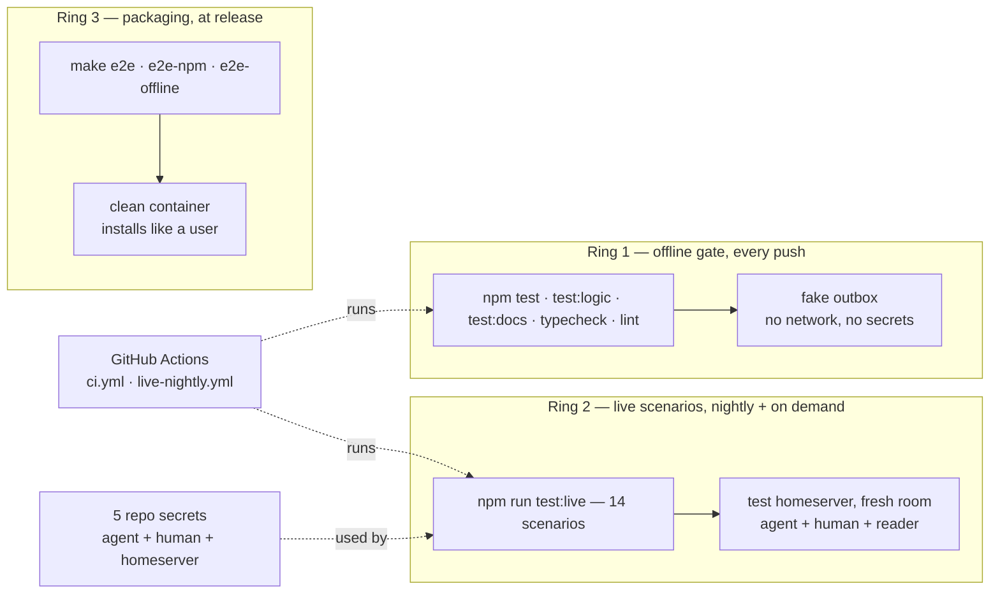

# QA: strategy, setup, and how to run the tests

This document is the QA overview for the extension. It covers four things:
the test strategy — three rings and what each proves (§1); how each ring
is set up and what Matrix topology it runs on, including the three test
identities (§2); which tool does what — npm scripts, `make`, docker, CI
(§3–§4); and the concrete steps to set up and run everything yourself
([§5. Test Setup and Run](#5-test-setup-and-run)).



**What makes a good test here: assert on the room, never on internal
state.** The extension's real output is what appears in the Matrix room;
its internal variables are not. A test that checks internal state can pass
while the room shows nothing — a broken integration can still hold tidy
internals. So in every ring, a claim about user-visible behaviour counts
only when it is verified against the room itself: fetched over the
client-server API, by a client that is not the one under test.

## 1. Strategy: three rings

| Ring | Commands | Question it answers | When | Network / model |
|---|---|---|---|---|
| **Offline gate** | `npm test`, `npm run test:logic`, `npm run test:docs`, `typecheck`, `lint` | Does every branch behave, deterministically, with no network to flake on? | every push (CI) + the local loop | no / no |
| **Live scenarios** | `npm run test:live` | Does what the extension claims actually land in a real Matrix room, and can a stranger read it back? | nightly CI + on demand | yes / yes |
| **Packaging** | `make e2e`, `make e2e-npm`, `make e2e-offline` | Does a clean machine that installed the way a user does end up working? | at release | yes / no¹ |

¹ the offline container target has *no* network at all, on purpose.
**REVIEW COMMENT: this footnote does not make sense. It refers to the packaging network/model column, where it states `yes / no¹`. The footnote refers to the model (which says "no"), and then the value before for network says "yes" - which contradicts what the footnote is saying. So what was the point being made here?**

Ad hoc, never gates: `npm run test:repro` (one bug, one script),
`npm run test:live:judge` (an LLM grades summary quality once per release),
`npm run test:perf` (reserved — fails until the perf stories land).

Why three rings and not one big suite: the push ring must never be flaky,
so it gets no network; the live ring is where claims meet reality, so it is
allowed to be slow and needs accounts; the packaging ring tests the
*artifact*, which neither of the other two ever installs.

## 2. Each ring: what is tested, and on what Matrix setup

### 2.1 Offline gate — a fake Matrix, all of the logic

**Context:** the code has to run its full cycle — milestones out, messages in,
question mirrors, thread summaries — but a push gate cannot depend on a
homeserver. *Resolution:* a fake outbox.

- **Setup:** `npm ci`, nothing else. Two seams make it hermetic:
  `PI_MATRIX_TEST_OUTBOX` swaps the real transport for
  `test/fake-outbox.mjs`, `PI_MATRIX_TEST` marks the hermetic run.
- **What is tested:** `npm test` — units plus one full stubbed e2e cycle,
  budget under 120 s. `npm run test:logic` — the deep per-subsystem
  contracts: funnel/config/attach, threading and the summary cadence
  (see `test/logic/01-threading.mjs`), transport and footer, and the sdk
  crypto suite, which runs real Olm/Megolm code offline.
  `npm run test:docs` — links resolve, no maintainer-only identifiers ship,
  no stale comment references.
- **Matrix setup:** none. The fake records every would-be send and the
  assertions read the recording.

### 2.2 Live scenarios — a real Matrix room

**Context:** the fake outbox cannot tell you what Synapse really did with your
event. The only witness a maintainer can trust is the room, fetched from
the outside. *Resolution:* drive a real homeserver, then read it back.

- **Setup:** a throwaway **test homeserver** plus three identities (below),
  exported from `docker/.env` (see §4). Never a real account — AGENTS.md
  rule 1 permits no other target.
- **What is tested:** the 14 named scenarios in `test/live/scenarios.mjs`:
  milestone out, TODO progress, turn final out, message-in attribution,
  questionnaire mirror, answer race (terminal vs room), thread-per-session,
  summary rewrites the root, summary survives `/compact` and a restart,
  commands from the room, attachment round trip, footer status, scripted
  tour. Each scenario asserts on room bodies fetched over the API. The
  human confirmation walkthrough per scenario:
  [test/live/README.md](../../test/live/README.md).
- **Matrix setup:** a fresh room per run (`live-e2e-<run-id>`), so reruns
  cannot interfere; per-scenario evidence (JSON + SDK log) in
  `artifacts/live-<run-id>/`; a sweep tool (§3) purges old test rooms. A
  test homeserver that only speaks `http://` on a non-local address needs
  the explicit opt-in `PI_MATRIX_ALLOW_INSECURE_HTTP=1` (never applies to
  `https://`).

**The three test identities.**

| Persona | `.env` name | Who it plays |
|---|---|---|
| **Agent** | `pi_agent` (`PI_MATRIX_USERNAME`) | The extension under test: the bot that joins, posts, relays, and summarizes. |
| **Human** | `you` (`PI_MATRIX_SECOND_USER`) | The scripted phone user: joins the room, posts messages, answers questions. Also the Synapse admin identity for the room sweep. |
| **Reader** | often a second device of `pi_agent` (`PI_MATRIX_READER_*`) | The verifier: a third Matrix client that sits in the room and reads it back so the assertions have a witness. |

**Why the reader has to exist.** On a homeserver without room encryption,
the reading client can just borrow the agent's token — that is what the
suite does when no reader is configured. But a default-encryption Synapse
encrypts every new room and there is no client-side opt-out, and *reading
then means decrypting*. Decryption needs a device with its own Olm/Megolm
crypto store, and a crypto store is device-exclusive: the agent's store is
locked by the very process under test, and the human's login is there to
post, not to verify. So the third identity exists: it logs in (the first
run mints a fresh device and a `credentials.json` with a persistent crypto
store beside it; later runs reuse that device), gets invited to the room
like any member, and receives the room keys like any member. The nightly
mints a fresh reader device from the agent account's login every run,
because a stateless CI runner cannot carry a crypto store — and reusing a
stored `device_id` with an empty store registers a *new* identity under the
*old* device, whose keys can never be unwrapped (it shows up as `NoOlm` /
withheld-key).

### 2.3 Packaging — prove the artifact, not the tree

**Context:** users install Pi and this extension from a tarball or the npm
registry, on a machine with no repo checkout, no devDependencies, and no
`$HOME` full of working config. No other ring ever tests that machine.
*Resolution:* a container that starts clean and installs like a user.

- **Setup:** Docker + compose plugin; `npm ci` on the host (node_modules
  rides into the offline target); credentials arrive only as environment
  variables at run time — nothing secret lives in the image.
- **What is tested:** cold install → the extension logs in → it runs the
  live scenario tier *inside* the container (`make e2e`), or from the
  published npm artifact (`make e2e-npm`), or the offline tier with
  `network_mode: "none"` to prove `npm test` is really offline
  (`make e2e-offline`). Full notes: [docker/README.md](../../docker/README.md).
- **Matrix setup:** the same test homeserver and accounts as §2.2 — the
  container reads them from `docker/.env` through compose. If the reader
  vars are missing, the in-container live tier fails exactly the way a
  host-side run does (see §5).

## 3. Tools and their roles

| Tool | Role |
|---|---|
| npm scripts in `test` | the test tiers themselves (§1) |
| `Makefile` + `docker/` | the packaging ring: `make build`, `e2e`, `e2e-npm`, `e2e-offline` (§2.3), `shell` for a manual walkthrough, `clean` to tear down. The Pi version inside the container is pinned (`PI_VERSION`, default in the Makefile) — `make e2e` proves the pinned version, not the latest. |
| `docker/sweep-test-rooms.mjs` | cleanup: purges agent-created `e2e-*`/`live-e2e-*`/`optout-*` rooms older than `SWEEP_TTL_DAYS` (default 7) via the Synapse admin API |
| `docker/.env.example` | the tracked environment template; your filled copy under `docker/` stays git-ignored |
| GitHub Actions | runs the push gate, the nightly live tier, the supply-chain audit, and the release publish — see §4 |

## 4. GitHub Actions setup

**REVIEW COMMENT: I MISS HERE HOW THE 4 WORKFLOWS (CI, Dependencies, Live nightly and Release) MATCH WHICH RING.**

We run 4 workflows in our CI process — each belongs to a ring of §1, or
protects the ground the rings run on:

| Workflow | Ring | What it covers |
|---|---|---|
| `ci.yml` | **Ring 1** (offline gate) + packaging ground | `gate` runs exactly Ring 1's commands; `manifest` proves the *artifact's* ground is sound — clean install, dependency contract, secret scan on the packed tarball — without a network or a container |
| `deps.yml` | supply chain (supports Ring 3) | never runs code of ours: audits what the rings would install |
| `live-nightly.yml` | **Ring 2** (live scenarios) | the nightly run of `test:live` on the real homeserver; the only workflow holding secrets |
| `release.yml` | Ring 3's gate, not Ring 3 itself | the `prepack` guard and publish; the `make e2e*` container proofs stay a maintainer act, run by hand at release time |

| Workflow | Trigger | Jobs |
|---|---|---|
| `ci.yml` | every push / PR | `gate`: credential scan (plus a self-test that the scan can bite), typecheck, lint, `npm test`, docs-consistency. `manifest`: clean `npm ci --omit=dev`, dependency contract, secret scan on the unpacked tarball, tarball file allowlist. No secrets, no network. |
| `deps.yml` | schedule + lockfile changes | `npm audit --omit=dev` (fails on high/critical), registry signature verification |
| `live-nightly.yml` | daily 04:30 UTC + manual dispatch, `main` only | `npm run test:live`; `npm run test:perf` (continue-on-error until perf lands). Evidence uploaded; a failure opens (or reuses) one tracking issue |
| `release.yml` | version tag | `prepack` publish guard, then publish |

**Concern:** the live nightly requires credentials, but they must never run where a
stranger's pull request can reach them. *Resolution:* only one workflow
holds secrets, and it runs on `main` alone.

**The five repository secrets** (GitHub → Settings → Secrets and variables
→ Actions, exact case):

- `PI_MATRIX_HOMESERVER` — the https URL of the test homeserver
- `PI_MATRIX_USERNAME` + `PI_MATRIX_PASSWORD` — the agent account
- `PI_MATRIX_SECOND_USER` + `PI_MATRIX_SECOND_PASSWORD` — the human seat
  (`PI_MATRIX_SECOND_TOKEN` is read too; tokens expire, passwords do not)

No sixth secret for the reader: the workflow derives `PI_MATRIX_READER_USER`
/ `PI_MATRIX_READER_PASSWORD` from the agent account's secrets — the fresh
device per run described in §2.2. **This is not a privilege CI has and you
do not.** "Derive" means nothing more than exporting those two variables
from the agent username/password that are already in the environment. The
suite only reads env vars; it does not know or care who set them. Locally
the identical derivation belongs in your env file —
`docker/.env.example` ships exactly these two lines (reader user/password
referencing the agent's). A run fails the way today's did only because the
env file predates that sample.

Why is it a variable at all instead of hardcoded into the suite? Two
reasons. On a server without auto-encryption no reader is needed — the
plain reader just borrows the agent's token. And on an encrypting server
the reader mints a real device and, locally, a persistent crypto store on
disk; the suite will not silently create devices and store key material in
your accounts. The env var is the explicit go-ahead — CI simply carries it
in the workflow file instead of an env file.

The workflow also points `PI_MATRIX_TEST_PI_PKG` at the devDependency-installed
Pi package, because a runner has no `pi` on `PATH`.

Provision the accounts with the manifest shape in
[test/live/accounts-manifest.example.json](../../test/live/accounts-manifest.example.json).

## 5. Test Setup and Run

```bash
# 1 — offline gate: no accounts, no network needed
npm ci
npm run typecheck && npm run lint
npm test && npm run test:docs && npm run test:logic

# 2 — environment for the live rings
cp docker/.env.example docker/.env     # fill in homeserver + accounts
source docker/.env

# 3 — provision the three test identities on the TEST homeserver
#     (manifest shape: test/live/accounts-manifest.example.json;
#      the reader may reuse the agent account's login — one extra device)

# 4 — live tier
npm run test:live                      # expect 14/14

# 5 — on any failure, read the witness
less artifacts/live-<run-id>/summary.json
less artifacts/live-<run-id>/pi-matrix-http-sdk.log
```

## 6. Triage signatures

- **`This room is configured to use encryption, but your client does not
  support encryption`** in the SDK log, followed by a cascade of timeouts
  (questionnaire, thread roots, restart post) and `sdk transport
  unavailable`: the reader env pair is missing on an auto-encrypting
  homeserver. Early scenarios may pass — their sends left before the first
  sync revealed the room's encryption. Fix: export
  `PI_MATRIX_READER_USER` + `PI_MATRIX_READER_PASSWORD` and rerun.
- **Empty `""` bodies in timeout evidence** — same diagnosis from the
  reading side: a reader without crypto cannot see Megolm event bodies.
- **`NoOlm` / withheld-key in the reader log** — a stored `device_id`
  against an empty crypto store: a new identity wearing an old device's
  name. Mint a fresh device (CI does this by design; locally, remove the
  reader's stale `device_id`).
- **Nightly opens a `Nightly live gate failed` issue** — read the uploaded
  `live-nightly-<run>` artifact; the per-scenario JSON names the marker and
  the last-seen room bodies.
